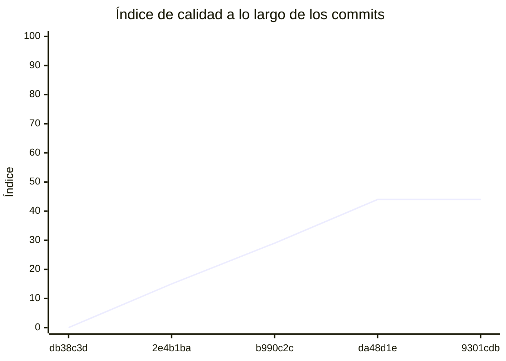

<!-- evaluacion:inicio -->
# Evaluación — TONEATTI-PROGRAMACION-TRABAJO-FINAL/App-kmp

> Documento **generado automáticamente** por la cátedra de Programación II (UM): RepoSense + análisis de calidad de **7 dimensiones**. **No editar a mano**: se regenera en cada evaluación.
> Rama evaluada: `main`. Análisis **heurístico** (regex + métricas) + build: es una criba para orientar la revisión, **no una nota**. La **documentación** del repositorio no se evalúa.
> Generado: 2026-11-18.

## 1. Veredicto

| Aspecto | Resultado |
|---|---|
| Índice de calidad | **44/100** |
| Tipo de repositorio | `app-kmp` |
| Build (`mvnw verify` / `gradlew check`) | OK |
| Código (LOC) | 3,229 |
| Archivos de código | 56 |
| Clases | 62 |
| Código dentro de clases (%POO) | 61% |
| Funciones fuera de clases | 0 |
| Duplicación (puerta) | 5.7% |
| Duplicación lógica | 5.8% |
| Duplicación de boilerplate | 17.3% |
| Tope duro aplicado a D1 | `POO_BAJO` → D1 ≤ 60 |

> Este informe **describe** lo que el análisis midió con los criterios ya establecidos de la materia. No es una nota.

## 2. Semáforo de aprobación

Criterios de la cátedra (`CRITERIOS-CALIDAD.md`): **Aprobar** se juega con el perfil `estandar`; **destacar**, con el `exigente` (meta de excelencia).

| Semáforo | Resultado |
|---|---|
| Aprobar (`estandar`) | **no cumple** — 6/11 |
| Destacar (`exigente`) | **no cumple** — 5/11 |

**Para aprobar, falta cumplir:** Duplicación

**Para destacar, falta cumplir:** POO; Duplicación

## 3. Autoría (RepoSense)

| Autor | Commits | Código (LOC) | Tests (LOC) | Docs (LOC) | Días activos | % del código |
|---|---:|---:|---:|---:|---:|---:|
| LucianoToneatti | 20 | 3,664 | 0 | 28 | 11 | 100% |

> _El LOC de autoría lo calcula RepoSense sobre el historial y puede diferir del LOC de código del análisis (que mira el estado de `main`)._

## 4. Dimensiones evaluadas

Cada dimensión indica **qué mide**, **por qué importa** y **tu resultado**. Cuando el puntaje queda por debajo de la referencia, se agregan preguntas para **investigar la causa** (no hay recetas).

| Dimensión | Peso | Puntaje |
|:--|--:|--:|
| **D1** Diseño OO, SOLID y patrones (20%) | 20% | 4 |
| **D2** Arquitectura hexagonal — backend (15%) | 15% | N/A |
| **D3** Frontend KMP: MVVM y buenas prácticas (10%) | 10% | 93 |
| **D4** Integración y contrato (10%) | 10% | N/A |
| **D5** Seguridad y robustez (10%) | 10% | 95 |
| **D6** Pruebas y cobertura (20%) | 20% | 43 |
| **D7** Proceso y entrega (15%) | 15% | 31 |

### D1. Diseño OO, SOLID y patrones (20%)

- **Qué mide:** Métricas orientadas a objetos (clases, métodos, campos, cohesión, acoplamiento, herencia) y proxies de SOLID, más patrones de diseño.
- **Por qué importa:** El eje de la materia es el buen uso de la POO y su arquitectura: un diseño con clases claras y poco acopladas es más fácil de entender, probar y cambiar.
- **Tu resultado:** **4/100**
- **Para investigar la causa:**
    - ¿Se pensó el modelo de clases antes de codificar o se agrupó después?
    - ¿Qué clases concentran muchas responsabilidades a la vez?
    - ¿Los colaboradores llegan como parámetros o se crean por dentro?

### D3. Frontend KMP: MVVM y buenas prácticas (10%)

- **Qué mide:** Uso de ViewModel, estado de UI y flujo unidireccional, y ausencia de acceso a red/BD dentro de la UI.
- **Por qué importa:** Separar la UI del estado y del acceso a datos hace la app más predecible, testeable y menos propensa a bugs de ciclo de vida.
- **Tu resultado:** **93/100**

### D5. Seguridad y robustez (10%)

- **Qué mide:** Credenciales embebidas, consultas SQL por concatenación, y presencia de config de entorno; aislamiento de secretos.
- **Por qué importa:** Un secreto en el repositorio o una consulta construida por concatenación son riesgos concretos, no hipotéticos.
- **Tu resultado:** **95/100**

### D6. Pruebas y cobertura (20%)

- **Qué mide:** Cantidad y resultado de pruebas y cobertura de línea (JaCoCo/Kover, Surefire/Failsafe) cuando hay build.
- **Por qué importa:** Las pruebas son la red de seguridad para refactorizar e integrar; la cobertura acota las zonas sin verificar.
- **Tu resultado:** **43/100**
- **Para investigar la causa:**
    - ¿Qué partes del sistema no tienen pruebas?
    - ¿Las pruebas cubren caminos de error o solo el caso feliz?
    - ¿Qué falla al ejecutar la suite completa (no solo la del módulo propio)?

### D7. Proceso y entrega (15%)

- **Qué mide:** Artefactos verificables de proceso/entrega: `compose`, `.env.example`, CI (`.github/workflows/`), `CODEOWNERS` y wrapper de build (`mvnw`/`gradlew`). **No** puntúa documentación.
- **Por qué importa:** Un proyecto que compila, se levanta y se valida solo es más fácil de revisar y de integrar en equipo.
- **Tu resultado:** **31/100**
- **Para investigar la causa:**
    - ¿El proyecto se levanta con un único comando desde el repo limpio?
    - ¿Qué pasa en CI cuando se sube un cambio?
    - ¿La configuración necesaria está versionada (sin secretos)?

## 5. Señales detectadas

El análisis encontró las siguientes señales, con el archivo y la línea donde se originan cuando están disponibles:

**Archivos con más señales**

| Archivo | Señales |
|---|---:|
| `shared/src/commonMain/kotlin/com/toneatti/app/ui/screens/ProfessionalsScreen.kt` | 6 |
| `shared/src/commonMain/kotlin/com/toneatti/app/viewmodel/RegisterViewModel.kt` | 4 |
| `shared/src/commonMain/kotlin/com/toneatti/app/data/auth/AuthApi.kt` | 4 |
| `shared/src/commonMain/kotlin/com/toneatti/app/data/auth/AuthRepository.kt` | 4 |
| `shared/src/commonMain/kotlin/com/toneatti/app/navigation/MainScreen.kt` | 4 |
| `shared/src/commonMain/kotlin/com/toneatti/app/ui/screens/auth/LoginScreen.kt` | 4 |
| `shared/src/commonMain/kotlin/com/toneatti/app/viewmodel/AuthFormValidator.kt` | 3 |
| `shared/src/commonMain/kotlin/com/toneatti/app/viewmodel/LoginViewModel.kt` | 3 |
| `shared/src/commonMain/kotlin/com/toneatti/app/ui/screens/auth/RegisterScreen.kt` | 3 |
| `androidApp/src/main/kotlin/com/toneatti/app/MainActivity.kt` | 2 |

**DIP/concretos** (40)
- clase 'MainActivity' muy acoplada (CBO=11) — `androidApp/src/main/kotlin/com/toneatti/app/MainActivity.kt:18`
- clase 'MainActivity' instancia 3 concretos (CBO=11) — `androidApp/src/main/kotlin/com/toneatti/app/MainActivity.kt:18`
- clase 'AndroidTokenStorage' muy acoplada (CBO=43) — `shared/src/androidMain/kotlin/com/toneatti/app/data/session/TokenStorage.android.kt:34`
- clase 'AndroidTokenStorage' instancia 3 concretos (CBO=43) — `shared/src/androidMain/kotlin/com/toneatti/app/data/session/TokenStorage.android.kt:34`
- clase 'App' muy acoplada (CBO=11) — `shared/src/commonMain/kotlin/com/toneatti/app/App.kt:28`
- clase 'App' instancia 5 concretos (CBO=11) — `shared/src/commonMain/kotlin/com/toneatti/app/App.kt:28`
- clase 'AppContainer' muy acoplada (CBO=9) — `shared/src/commonMain/kotlin/com/toneatti/app/AppContainer.kt:23`
- clase 'AuthApi' muy acoplada (CBO=43) — `shared/src/commonMain/kotlin/com/toneatti/app/data/auth/AuthApi.kt:30`
- clase 'AuthApi' instancia 12 concretos (CBO=43) — `shared/src/commonMain/kotlin/com/toneatti/app/data/auth/AuthApi.kt:30`
- clase 'AuthRepository' muy acoplada (CBO=12) — `shared/src/commonMain/kotlin/com/toneatti/app/data/auth/AuthRepository.kt:12`
- clase 'DefaultAuthRepository' muy acoplada (CBO=12) — `shared/src/commonMain/kotlin/com/toneatti/app/data/auth/AuthRepository.kt:57`
- clase 'DefaultAuthRepository' instancia 3 concretos (CBO=12) — `shared/src/commonMain/kotlin/com/toneatti/app/data/auth/AuthRepository.kt:57`
- clase 'ApiConfig' muy acoplada (CBO=8) — `shared/src/commonMain/kotlin/com/toneatti/app/data/remote/ApiConfig.kt:9`
- clase 'TurnosHttpClient' muy acoplada (CBO=17) — `shared/src/commonMain/kotlin/com/toneatti/app/data/remote/TurnosHttpClient.kt:25`
- clase 'UserSession' muy acoplada (CBO=8) — `shared/src/commonMain/kotlin/com/toneatti/app/data/session/UserSession.kt:18`
- clase 'UserSession' instancia 3 concretos (CBO=8) — `shared/src/commonMain/kotlin/com/toneatti/app/data/session/UserSession.kt:18`
- clase 'AppDestination' muy acoplada (CBO=15) — `shared/src/commonMain/kotlin/com/toneatti/app/navigation/AppDestination.kt:28`
- clase 'AppDestination' instancia 7 concretos (CBO=15) — `shared/src/commonMain/kotlin/com/toneatti/app/navigation/AppDestination.kt:28`
- clase 'MainScreen' muy acoplada (CBO=46) — `shared/src/commonMain/kotlin/com/toneatti/app/navigation/MainScreen.kt:56`
- clase 'MainScreen' instancia 22 concretos (CBO=46) — `shared/src/commonMain/kotlin/com/toneatti/app/navigation/MainScreen.kt:56`
- clase 'AppBottomBar' muy acoplada (CBO=9) — `shared/src/commonMain/kotlin/com/toneatti/app/ui/components/AppBottomBar.kt:21`
- clase 'AppBottomBar' instancia 5 concretos (CBO=9) — `shared/src/commonMain/kotlin/com/toneatti/app/ui/components/AppBottomBar.kt:21`
- clase 'BookingsScreen' muy acoplada (CBO=8) — `shared/src/commonMain/kotlin/com/toneatti/app/ui/screens/BookingsScreen.kt:24`
- clase 'BookingsScreen' instancia 5 concretos (CBO=8) — `shared/src/commonMain/kotlin/com/toneatti/app/ui/screens/BookingsScreen.kt:24`
- clase 'ProfessionalsScreen' muy acoplada (CBO=8) — `shared/src/commonMain/kotlin/com/toneatti/app/ui/screens/ProfessionalsScreen.kt:24`
- clase 'ProfessionalsScreen' instancia 5 concretos (CBO=8) — `shared/src/commonMain/kotlin/com/toneatti/app/ui/screens/ProfessionalsScreen.kt:24`
- clase 'SettingsScreen' muy acoplada (CBO=17) — `shared/src/commonMain/kotlin/com/toneatti/app/ui/screens/SettingsScreen.kt:31`
- clase 'SettingsScreen' instancia 10 concretos (CBO=17) — `shared/src/commonMain/kotlin/com/toneatti/app/ui/screens/SettingsScreen.kt:31`
- clase 'LoginScreen' muy acoplada (CBO=29) — `shared/src/commonMain/kotlin/com/toneatti/app/ui/screens/auth/LoginScreen.kt:37`
- clase 'LoginScreen' instancia 23 concretos (CBO=29) — `shared/src/commonMain/kotlin/com/toneatti/app/ui/screens/auth/LoginScreen.kt:37`
- clase 'RegisterScreen' muy acoplada (CBO=38) — `shared/src/commonMain/kotlin/com/toneatti/app/ui/screens/auth/RegisterScreen.kt:40`
- clase 'RegisterScreen' instancia 25 concretos (CBO=38) — `shared/src/commonMain/kotlin/com/toneatti/app/ui/screens/auth/RegisterScreen.kt:40`
- clase 'AuthErrorMessages' muy acoplada (CBO=12) — `shared/src/commonMain/kotlin/com/toneatti/app/viewmodel/AuthErrorMessages.kt:11`
- clase 'AuthFormValidator' muy acoplada (CBO=11) — `shared/src/commonMain/kotlin/com/toneatti/app/viewmodel/AuthFormValidator.kt:15`
- clase 'LoginViewModel' muy acoplada (CBO=14) — `shared/src/commonMain/kotlin/com/toneatti/app/viewmodel/LoginViewModel.kt:26`
- clase 'LoginViewModel' instancia 4 concretos (CBO=14) — `shared/src/commonMain/kotlin/com/toneatti/app/viewmodel/LoginViewModel.kt:26`
- clase 'RegisterViewModel' muy acoplada (CBO=20) — `shared/src/commonMain/kotlin/com/toneatti/app/viewmodel/RegisterViewModel.kt:27`
- clase 'RegisterViewModel' instancia 4 concretos (CBO=20) — `shared/src/commonMain/kotlin/com/toneatti/app/viewmodel/RegisterViewModel.kt:27`
- clase 'SessionViewModel' muy acoplada (CBO=9) — `shared/src/commonMain/kotlin/com/toneatti/app/viewmodel/SessionViewModel.kt:19`
- clase 'SessionViewModel' instancia 3 concretos (CBO=9) — `shared/src/commonMain/kotlin/com/toneatti/app/viewmodel/SessionViewModel.kt:19`

**OCP/type-switch** (4)
- clase 'DefaultAuthRepository' con 6 type-checks — `shared/src/commonMain/kotlin/com/toneatti/app/data/auth/AuthRepository.kt:57`
- clase 'AuthErrorMessages' con 2 type-checks — `shared/src/commonMain/kotlin/com/toneatti/app/viewmodel/AuthErrorMessages.kt:11`
- clase 'LoginViewModel' con 2 type-checks — `shared/src/commonMain/kotlin/com/toneatti/app/viewmodel/LoginViewModel.kt:26`
- clase 'RegisterViewModel' con 4 type-checks — `shared/src/commonMain/kotlin/com/toneatti/app/viewmodel/RegisterViewModel.kt:27`

**POO** (4)
- clase 'RegisterRequest' con 4 campos públicos (encapsulación) — `shared/src/commonMain/kotlin/com/toneatti/app/data/auth/dto/RegisterRequest.kt:14`
- clase 'AuthFormValidator' con 5 campos públicos (encapsulación) — `shared/src/commonMain/kotlin/com/toneatti/app/viewmodel/AuthFormValidator.kt:15`
- clase 'LoginUiState' con 7 campos públicos (encapsulación) — `shared/src/commonMain/kotlin/com/toneatti/app/viewmodel/LoginUiState.kt:16`
- clase 'RegisterUiState' con 12 campos públicos (encapsulación) — `shared/src/commonMain/kotlin/com/toneatti/app/viewmodel/RegisterUiState.kt:21`

**SRP/responsabilidad** (8)
- método 'AuthApi.request' de 36 líneas — `shared/src/commonMain/kotlin/com/toneatti/app/data/auth/AuthApi.kt:110`
- método 'AuthApi.request' con complejidad 9 — `shared/src/commonMain/kotlin/com/toneatti/app/data/auth/AuthApi.kt:110`
- método 'MainScreen.Content' de 107 líneas — `shared/src/commonMain/kotlin/com/toneatti/app/navigation/MainScreen.kt:66`
- método 'MainScreen.Content' con complejidad 8 — `shared/src/commonMain/kotlin/com/toneatti/app/navigation/MainScreen.kt:66`
- método 'LoginScreen.Content' de 77 líneas — `shared/src/commonMain/kotlin/com/toneatti/app/ui/screens/auth/LoginScreen.kt:50`
- método 'RegisterScreen.Content' de 96 líneas — `shared/src/commonMain/kotlin/com/toneatti/app/ui/screens/auth/RegisterScreen.kt:55`
- clase 'AuthFormValidator' con baja cohesión (19%) — `shared/src/commonMain/kotlin/com/toneatti/app/viewmodel/AuthFormValidator.kt:15`
- clase 'RegisterViewModel' con baja cohesión (21%) — `shared/src/commonMain/kotlin/com/toneatti/app/viewmodel/RegisterViewModel.kt:27`

**duplicación** (6)
- duplicación lógica: 5.7% · boilerplate: 17.3%
- bloque de 8 líneas repetido 3 veces en shared/src/commonMain/kotlin/com/toneatti/app/ui/screens/ProfessionalsScreen.kt:33, shared/src/commonMain/kotlin/com/toneatti/app/ui/screens/BookingsScreen.kt:33, shared/src/commonMain/kotlin/com/toneatti/app/ui/screens/SettingsScreen.kt:46 — `shared/src/commonMain/kotlin/com/toneatti/app/ui/screens/ProfessionalsScreen.kt:33`
- bloque de 8 líneas repetido 3 veces en shared/src/commonMain/kotlin/com/toneatti/app/ui/screens/ProfessionalsScreen.kt:34, shared/src/commonMain/kotlin/com/toneatti/app/ui/screens/BookingsScreen.kt:34, shared/src/commonMain/kotlin/com/toneatti/app/ui/screens/SettingsScreen.kt:47 — `shared/src/commonMain/kotlin/com/toneatti/app/ui/screens/ProfessionalsScreen.kt:34`
- bloque de 8 líneas repetido 2 veces en shared/src/commonMain/kotlin/com/toneatti/app/ui/screens/ProfessionalsScreen.kt:37, shared/src/commonMain/kotlin/com/toneatti/app/ui/screens/BookingsScreen.kt:37 — `shared/src/commonMain/kotlin/com/toneatti/app/ui/screens/ProfessionalsScreen.kt:37`
- bloque de 8 líneas repetido 2 veces en shared/src/commonMain/kotlin/com/toneatti/app/ui/screens/ProfessionalsScreen.kt:41, shared/src/commonMain/kotlin/com/toneatti/app/ui/screens/BookingsScreen.kt:41 — `shared/src/commonMain/kotlin/com/toneatti/app/ui/screens/ProfessionalsScreen.kt:41`
- bloque de 8 líneas repetido 2 veces en shared/src/commonMain/kotlin/com/toneatti/app/ui/screens/auth/LoginScreen.kt:115, shared/src/commonMain/kotlin/com/toneatti/app/ui/screens/auth/RegisterScreen.kt:139 — `shared/src/commonMain/kotlin/com/toneatti/app/ui/screens/auth/LoginScreen.kt:115`

## 6. Evolución por commit

Métricas calculadas sobre el estado de `main` en **cada commit** (5 commits con trabajo), del primero al último. La calidad usa el perfil `exigente`; el aporte de código lo mide RepoSense. El índice puede **bajar** al crecer el proyecto: se acumulan señales.

| # | Fecha | Commit | Autor | LOC | Índice | %POO | Duplic. | Sueltas |
|---|---|---|---|---:|---:|---:|---:|---:|
| 1 | 2026-09-10 | `db38c3d` | LucianoToneatti | 0 | 0 | 0% | 0.0% | 0 |
| 2 | 2026-09-15 | `2e4b1ba` | Ing. Daniel Quinteros | 0 | 15 | 0% | 0.0% | 0 |
| 3 | 2026-10-20 | `b990c2c` | LucianoToneatti | 798 | 29 | 44% | 15.8% | 0 |
| 4 | 2026-10-22 | `da48d1e` | LucianoToneatti | 3,214 | 44 | 61% | 5.7% | 0 |
| 5 | 2026-10-29 | `9301cdb` | LucianoToneatti | 3,229 | 44 | 61% | 5.7% | 0 |

---
_Informe generado por la cátedra. Las dimensiones y umbrales corresponden a `calidad.py` (perfil `exigente`); el semáforo, a `CRITERIOS-CALIDAD.md`. La documentación del repositorio no se evalúa. Ante dudas, revisá el archivo señalado._
<!-- evaluacion:fin -->
